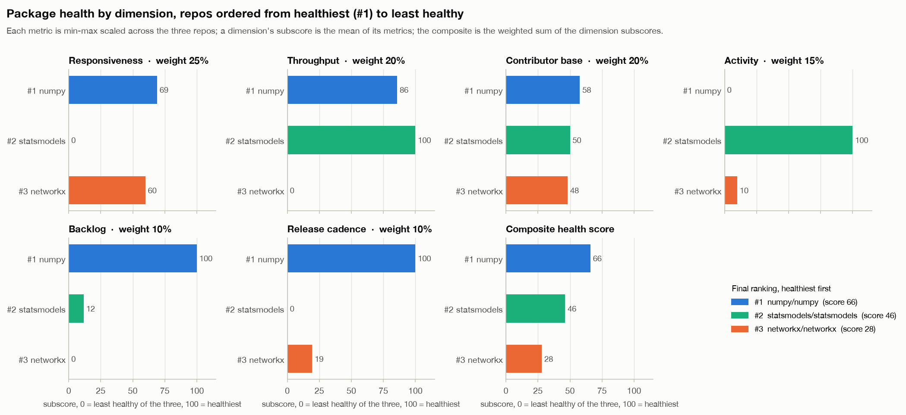
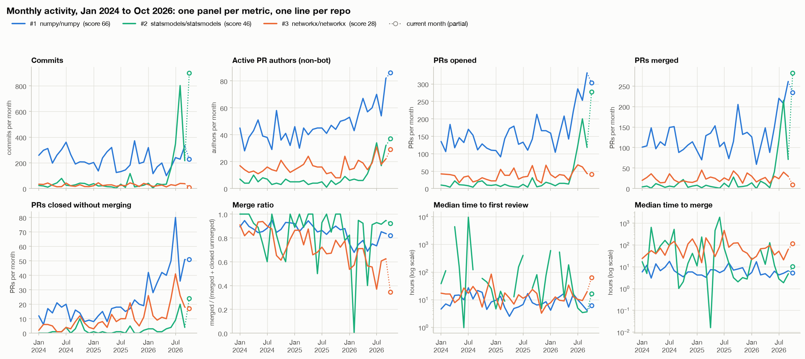
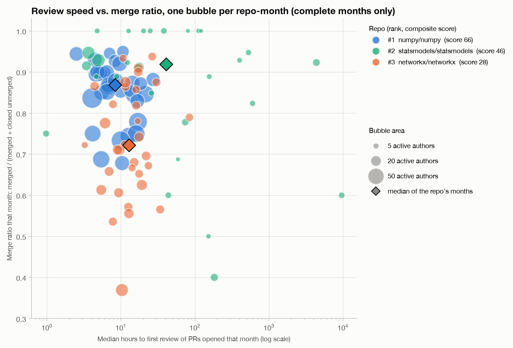

# Open-Source Package Health: GitHub Data Pipeline

DS 3022 · Data Project 2 · **Package set A**: `numpy/numpy` (large), `networkx/networkx`, `statsmodels/statsmodels`

One Prefect flow, `tgc4mz-package-health-flow` in [main.py](main.py), pulls GitHub activity for the three
repositories from **2024-01-01 through the time of each run**, lands it as JSON, loads it into DuckDB, builds and
tests dbt models, validates the result in Python, scores each project's development-community health, and
plots the result. The assignment text is in [INSTRUCTIONS.md](INSTRUCTIONS.md); the submission checklist is
[CHECKLIST.md](CHECKLIST.md).

## Result

Run of 2026-10-31 (window 2024-01-01 to the run). Subscores are 0–100 (100 = healthiest of the three on that
dimension); the composite is their weighted sum.

| Rank | Repository | Health score | Responsiveness (25%) | Throughput (20%) | Contributor base (20%) | Activity (15%) | Backlog (10%) | Release cadence (10%) |
| ---: | --- | ---: | ---: | ---: | ---: | ---: | ---: | ---: |
| 1 | numpy/numpy | **65.9** | 69.0 | 85.7 | 57.7 | 0.0 | 100.0 | 100.0 |
| 2 | statsmodels/statsmodels | **46.2** | 0.0 | 100.0 | 50.0 | 100.0 | 11.7 | 0.0 |
| 3 | networkx/networkx | **28.0** | 59.8 | 0.0 | 48.2 | 9.9 | 0.0 | 19.4 |



## Setup and running

Requires Python 3.12+ (developed on 3.13) and a GitHub personal access token. A classic token with **no
scopes** is enough, since all three repositories are public; it still gets the 5,000 requests/hour limit.

```bash
git clone https://github.com/whauf/projectforproject2.git
cd projectforproject2
python3 -m venv .venv && source .venv/bin/activate
pip install -r requirements.txt
export GITHUB_TOKEN=<your token>
python main.py
```

| Command | What it does |
| --- | --- |
| `python main.py` | Runs the whole flow (Tasks 1–6). It decides by itself whether to fetch the full window, resume an interrupted run, or fetch incrementally. |
| `python main.py --graphql` | The same flow, but Task 1 fetches PRs and reviews through the GraphQL API (extended item). |
| `python main.py --reload` | Runs only Task 2 on the files already in `data/raw/` (shows that loads are idempotent). |
| `python main.py --deploy` | Registers the monthly deployment on the SDS Prefect server ([DEPLOYMENTS.md](DEPLOYMENTS.md)). |

**Expected runtime.** A full REST run makes **8,120 requests**, more than the 5,000-per-hour limit, so it
takes about **75 minutes**: roughly 25 minutes of fetching plus one wait for the hourly reset (45 minutes in my run).
Tasks 2–6 take under a minute. Later runs are incremental: **about 20 seconds and 13 requests**. A full run with
`--graphql` takes **about 2.5 minutes**.

The token is read from the `GITHUB_TOKEN` environment variable (or, for the deployment, from the Prefect
Secret block named by the `github_token_block` parameter). It never appears in the repository. Without
`PREFECT_API_URL` set, Prefect runs against a temporary local API; activate the `uvasds` profile from Canvas to
send the runs to the SDS server.

Everything the flow writes is ignored by git except `plots/`: `data/raw/` (landed API pages),
`packages.duckdb`, `logs/` (one log per task plus dbt's `dbt.log`), and dbt's `target/`. Three environment
variables exist only for quick development runs and were not used for the results: `PH_WINDOW_START`,
`PH_REPOS`, and `PH_ALLOW_ANONYMOUS`.

## Repository layout

```
main.py                 the @flow and its six tasks; CLI (--graphql, --reload, --deploy)
pipeline/
  config.py             package set, window start, paths, one color per repo
  client.py             GitHub client: rate limiters, API odometer, error classification, stop flag
  extract.py            Task 1 helpers: run planning, pagination, landing files, helper tasks, GraphQL query
  load.py               Task 2 helpers: raw tables, upserts, _load_state
  validate.py           Task 4 helpers: completeness checks, outlier scans, descriptive statistics
  model.py              Task 5 helpers: metric definitions, dimension weights, scoring
  plots.py              Task 6 helpers: the three PNGs
  logs.py               TaskLogger: every message to the Prefect logger and logs/<task>.log
dbt_project.yml, profiles.yml
models/staging/         sources.yml (raw tables as sources), schema.yml, stg_*.sql
models/marts/           schema.yml, fct_pull_requests, fct_releases, mart_repo_monthly, mart_repo_weekly, mart_health_inputs
macros/                 is_bot (the bot rule), run_time, window_start
tests/                  singular dbt tests
plots/                  the committed PNGs
```

## The flow

`package_health_flow` calls the six tasks in order; each one logs through the Prefect logger **and** to its own
file in `logs/` (`task1_extract.log` … `task6_plot.log`; dbt's own log is `logs/dbt.log`).

```
GitHub API ─Task 1─▶ data/raw/*.json ─Task 2─▶ raw_* tables ─Task 3 (dbt)─▶ stg / fct / marts ─Task 4─▶ checks
                                                                                              ─Task 5─▶ health_scores ─Task 6─▶ plots/
```

### Task 1 · Extract (`extract_github`)

**Endpoints and landing.** For each repo: `commits?since=…`, `pulls?state=all&sort=updated&direction=desc`
(paging stops after the page that crosses the window start or watermark), `releases` (in full), and
`pulls/{number}/reviews` for every PR created in the window, merged or not. Every request uses `per_page=100`
and follows the `Link` header's `rel="next"`. Each response page becomes one file,
`data/raw/<owner>__<repo>/<endpoint>/page_0001.json` (reviews: `reviews/pr_<number>/page_0001.json`),
holding `repo`, `endpoint`, `url`, `page`, `fetched_at`, and the unmodified response as `data`. Files are written
to a `.tmp` name and renamed when complete, so a crash cannot leave a half-written page. Record counts per
endpoint per repo are logged at the end of the task.

**Primary rate limit.** `RateLimiter` in [pipeline/client.py](pipeline/client.py) reads `X-RateLimit-Remaining`
and `X-RateLimit-Reset` from every response. Before each request, if 25 or fewer requests remain, the calling
thread sleeps until the reset time (plus 5 s); a lock makes the other repo threads queue behind it instead of
spending the last requests.

**Other HTTP errors.** `GitHubClient._raise_for_status` classifies every non-200 response:

| Response | Handling |
| --- | --- |
| 403/429 with `Retry-After` (secondary limit) | sleep for `Retry-After` seconds, then raise `TransientGitHubError` |
| 403/429 with `X-RateLimit-Remaining: 0` | raise `TransientGitHubError`; on the retry the limiter sleeps until the reset |
| 403/429 that mentions a rate limit, without `Retry-After` | wait 60 s, then raise `TransientGitHubError` |
| 5xx, timeouts and connection errors, unparseable JSON | raise `TransientGitHubError` |
| 404 on a PR's reviews | logged and skipped (the PR was deleted) |
| 401, other 403/4xx | raise `GitHubAPIError` (not retried: a retry cannot fix a bad token) |

The helper tasks (`fetch_listing`, `fetch_reviews`, `fetch_pulls_graphql`) use Prefect `retries=4` with
`retry_delay_seconds=exponential_backoff(backoff_factor=15)` (15, 30, 60, 120 s, ±50% jitter) and a
`retry_condition_fn` that retries only `TransientGitHubError`. A retry costs no extra quota for pages already
landed, because it resumes from disk.

**Resume or start fresh.** `plan_run` in [pipeline/extract.py](pipeline/extract.py) implements the table from
the assignment. If `data/raw/_LOADED` exists, everything on disk is already in DuckDB, so it deletes
`data/raw/` and fetches only what changed since the `_load_state` watermarks. If there is no marker but pages
are on disk, the last run stopped early: it keeps them, removes any leftover `.tmp` files, and `paginate`
reuses every page that parses (a page that fails to parse is fetched again). Because GitHub numbers its
pages, the URL after a reused page is the first URL with `page=N+1`; a reused page with fewer than 100 records
was the last one.

**Ctrl-C.** The repo threads would otherwise keep fetching after an interrupt (Python waits for worker threads
on exit). When Task 1 is interrupted, it sets the client's stop flag: every thread stops after its current
request, and a thread sleeping on the rate limit wakes immediately.

#### Interrupted run and its resumed run

The first full run (started at 12:51) was stopped partway through the PR reviews, leaving 4,052 landed pages.
The excerpts below are from `logs/task1_extract.log`. The next run resumed, reused everything already on disk,
used up the hour's budget, and was interrupted with **Ctrl-C** while it slept on the rate limit:

```
13:02:39 | INFO    | No _LOADED marker and 4052 landed pages on disk: the last run stopped before loading. Resume: keeping data/raw/, skipping pages already on disk (removed 0 half-written .tmp files).
13:02:39 | INFO    | networkx/networkx        commits     899 records on    9 pages (0 fetched, 9 reused from disk)
13:02:40 | INFO    | numpy/numpy              commits    7723 records on   78 pages (0 fetched, 78 reused from disk)
13:02:40 | INFO    | numpy/numpy              pulls      5900 records on   59 pages (0 fetched, 59 reused from disk)
13:02:40 | INFO    | statsmodels/statsmodels  reviews     821 records on 1100 pages for 1100 PRs (0 fetched, 1100 reused, 0 missing)
13:02:40 | INFO    | networkx/networkx        reviews    4182 records on 1285 pages for 1285 PRs (0 fetched, 1285 reused, 0 missing)
13:02:54 | INFO    | numpy/numpy              reviews  1500/5523 PRs done (44 pages fetched, 1456 reused) | odometer: 44 requests this run, rate budget left: 763
13:05:05 | INFO    | numpy/numpy              reviews  2000/5523 PRs done (544 pages fetched, 1456 reused) | odometer: 544 requests this run, rate budget left: 263
13:06:04 | WARNING | Rate limit: 25 of 5000 requests left; sleeping 2735 s until the reset at 13:51:35
13:06:11 | WARNING | Task 1 stopped by KeyboardInterrupt after 782 requests this run; the pages already in data/raw/ stay there for the next run to reuse
```

and Prefect reported `Crash detected! Execution was aborted by an interrupt signal.` The resumed run:

```
13:06:45 | INFO    | No _LOADED marker and 4834 landed pages on disk: the last run stopped before loading. Resume: keeping data/raw/, skipping pages already on disk (removed 0 half-written .tmp files).
13:06:45 | INFO    | numpy/numpy              commits    7723 records on   78 pages (0 fetched, 78 reused from disk)
13:06:45 | INFO    | numpy/numpy              pulls      5900 records on   59 pages (0 fetched, 59 reused from disk)
13:06:46 | INFO    | statsmodels/statsmodels  reviews     821 records on 1100 pages for 1100 PRs (0 fetched, 1100 reused, 0 missing)
13:06:46 | INFO    | networkx/networkx        reviews    4182 records on 1285 pages for 1285 PRs (0 fetched, 1285 reused, 0 missing)
13:06:46 | WARNING | Rate limit: 24 of 5000 requests left; sleeping 2693 s until the reset at 13:51:35
13:52:53 | INFO    | numpy/numpy              reviews  2500/5523 PRs done (262 pages fetched, 2238 reused) | odometer: 262 requests this run, rate budget left: 4613
14:06:32 | INFO    | numpy/numpy              reviews   10634 records on 5524 pages for 5523 PRs (3286 fetched, 2238 reused, 0 missing)
14:06:32 | INFO    | API odometer: 3286 requests this run {"numpy/numpy": {"reviews": 3286}} | rate-limit sleeps: 1 (2693 s) | Task 1 took 3588 s
14:06:43 | INFO    | Flow finished in 60.0 min | resume run | API odometer: 3286 GitHub requests | ranking: #1 numpy/numpy (65.9), #2 statsmodels/statsmodels (46.0), #3 networkx/networkx (28.0)
```

To check recovery from a page that is half-written when a crash hits, I truncated one landed page by hand
before resuming; the resumed run fetched only that page again:

```
12:58:03 | WARNING | Corrupt landing file numpy__numpy/pulls/page_0010.json (Unterminated string starting at: line 1 column 19994 (char 19993)): re-fetching that page
12:58:04 | INFO    | numpy/numpy              pulls      5900 records on   59 pages (1 fetched, 58 reused from disk)
```

**Concurrent fetching (extended).** `extract_github` maps the helper task `extract.extract_repo` over the
repos (`.map(...)` runs each repo in its own thread); all threads share one `GitHubClient`, whose
`RateLimiter` (lock-protected) and `Odometer` keep the total under the quota and count every request.

### Task 2 · Load (`load_to_duckdb`)

One table per endpoint (`raw_commits`, `raw_pull_requests`, `raw_pr_reviews`, `raw_releases`), one row per
record, with `repo`, `id` (natural key: sha, PR number, review id, release id), `updated_at` (commits: committer
date, the field `since` filters on; reviews: `submitted_at`; releases: `published_at`), `fetched_at`,
`source_file`, and the full record as `payload JSON`. The primary key is `(repo, id)`, and loads use
`INSERT OR REPLACE` (after keeping the newest fetch of a record within the batch), never blind inserts.

After every file has loaded, `_load_state` gets one row per repo and endpoint with the newest `updated_at`
(the watermark), the row count, and `loaded_at`; only then is `data/raw/_LOADED` created. The next run
requests commits `since` the watermark, stops paging PRs at the watermark, and asks for reviews only for the
PRs that are new or updated.

**Task 2 run twice on the same files** (the flow's load, then `python main.py --reload`):

```
# 1st load: Task 2 of the resumed flow run
14:06:33 | raw_commits         121 files,  11963 records,  11963 unique keys | rows before      0 -> after  11963 (11963 inserted, 0 replaced)
14:06:34 | raw_pull_requests    86 files,   8600 records,   8600 unique keys | rows before      0 -> after   8600 (8600 inserted, 0 replaced)
14:06:36 | raw_pr_reviews     7909 files,  15637 records,  15637 unique keys | rows before      0 -> after  15637 (15637 inserted, 0 replaced)
14:06:36 | raw_releases          4 files,    248 records,    248 unique keys | rows before      0 -> after    248 (248 inserted, 0 replaced)
# 2nd load of the same files: python main.py --reload
14:07:29 | raw_commits         121 files,  11963 records,  11963 unique keys | rows before  11963 -> after  11963 (0 inserted, 11963 replaced)
14:07:30 | raw_pull_requests    86 files,   8600 records,   8600 unique keys | rows before   8600 -> after   8600 (0 inserted, 8600 replaced)
14:07:31 | raw_pr_reviews     7909 files,  15637 records,  15637 unique keys | rows before  15637 -> after  15637 (0 inserted, 15637 replaced)
14:07:31 | raw_releases          4 files,    248 records,    248 unique keys | rows before    248 -> after    248 (0 inserted, 248 replaced)
```

**Request counts, full vs. incremental (API odometer).**

| Run | Requests | What they were |
| --- | ---: | --- |
| Full run (REST) | **8,120** | One per landed page: 121 commit pages, 86 PR pages, 4 release pages, and 7,909 review pages (one call for each of the 5,523 + 1,285 + 1,100 PRs; one numpy PR needed a second page). The run was split by the interruptions; the final resumed run logged `API odometer: 3286 requests this run`. |
| Incremental (REST) | **13** | One page each of new commits, of PRs down to the watermark, and of reviews for the PRs updated since (3 PRs), plus the 4 release pages. |
| Full run (GraphQL) | **298** | See the GraphQL comparison below. |

The incremental run, which followed the reload:

```
14:07:56 | INFO | Found data/raw/_LOADED: everything on disk is already in DuckDB. Start fresh: deleted data/raw/ and fetching only records updated since the _load_state watermarks.
14:07:56 | INFO | watermark  numpy/numpy              pulls    2026-10-31T16:50:56Z
14:07:58 | INFO | numpy/numpy              pulls       100 records on    1 pages (1 fetched, 0 reused from disk) in 1 s
14:07:58 | INFO | API odometer: 13 requests this run {"networkx/networkx": {"commits": 1, "pulls": 1, "releases": 1, "reviews": 1}, "numpy/numpy": {"commits": 1, "pulls": 1, "releases": 2, "reviews": 1}, "statsmodels/statsmodels": {"commits": 1, "pulls": 1, "releases": 1, "reviews": 1}}, GraphQL points spent: 0 | rate-limit sleeps: 0 (0 s) | Task 1 took 4 s
14:07:59 | INFO | raw_commits           3 files,      4 records,      4 unique keys | rows before  11963 -> after  11964 (1 inserted, 3 replaced)
14:07:59 | INFO | raw_pull_requests     3 files,    300 records,    300 unique keys | rows before   8600 -> after   8600 (0 inserted, 300 replaced)
14:08:05 | INFO | Flow finished in 0.2 min | incremental run | API odometer: 13 GitHub requests | ranking: #1 numpy/numpy (65.9), #2 statsmodels/statsmodels (46.2), #3 networkx/networkx (28.0)
```

### Task 3 · dbt (`dbt_build`)

`PrefectDbtRunner` runs `dbt build` inside the task; every model and test result is logged, and the task
raises if anything fails. Staging models are views; facts and marts are tables. All timestamps are cast to
`TIMESTAMPTZ` with the dbt session time zone set to UTC, so months and weeks are UTC calendar periods.
**Run time** is `max(fetched_at)` across the raw tables (`macros/run_time.sql`), so a rebuild without new
data gives the same results.

| Model | Grain | Notes |
| --- | --- | --- |
| `stg_commits`, `stg_pull_requests`, `stg_pr_reviews`, `stg_releases` | one per raw record | typed columns, latest row per `(repo, id)`, `is_bot`; PENDING reviews and draft releases dropped |
| `fct_pull_requests` | PR created on/after 2024-01-01 | `is_merged`, `is_closed_unmerged`, `is_open`, `first_review_at`, `hours_to_first_review`, `reviewed_within_7d`, `hours_to_merge`, `hours_to_close`, `is_stale`, `has_approving_review` |
| `fct_releases` | published release on/after 2024-01-01 | `days_since_previous` (lag computed before the window filter), `is_prerelease` |
| `mart_repo_monthly` | repo × month, Jan 2024 to the run month | month spine (quiet months show 0), opened/merged/closed-unmerged counts, `merge_ratio`, monthly medians, commits, active contributors, `is_partial_month` |
| `mart_repo_weekly` | repo × week | weekly commits, the outlier fence, `commits_capped` (see Task 4) |
| `mart_health_inputs` | repo | one column per scored metric; rates, shares, medians, and slopes only |

**Bot rule** (`macros/is_bot.sql`): `is_bot = user.type = 'Bot' OR user.login LIKE '%[bot]'`, applied to commit
authors, PR authors, and reviewers. An account that is missing (a commit email not linked to a GitHub user) is
not a bot. Bot reviews never count as a PR's first review, and bot PR authors are excluded from active
contributors and from the contributor-concentration metric.

**Open PRs and medians.** PRs still open at run time stay in `fct_pull_requests` with `is_open = true` and
no fake close date: `hours_to_merge` and `hours_to_close` are NULL for them. Medians of those durations
therefore describe finished PRs only. That flatters a project that leaves many PRs open, which is why the
model pairs `median_hours_to_merge` with `merge_rate` and the share of stale open PRs. Likewise, a PR that was
never reviewed has a NULL `hours_to_first_review` and drops out of the median, while
`pct_reviewed_within_7d` counts it as *not* reviewed within 7 days. Monthly medians use the PRs opened (first
review) or merged (merge time) in that month.

**Tests.** Generic: `unique` and `not_null` on every primary key (`commit_key`, `pr_key`, `review_key`,
`release_key`, and repo × month / repo × week in the marts), `relationships` from `stg_pr_reviews.pr_key` to
`stg_pull_requests.pr_key`, and `accepted_values` on PR state, review state, and `pr_status`. Singular:
`tests/assert_pr_closed_after_created.sql` (no PR closed or merged before it was created) and
`tests/assert_review_after_pr_created.sql` (no review submitted before its PR was created). Results, from
`logs/task3_dbt.log`:

```
14:08:04 | INFO | PASS    test  assert_pr_closed_after_created
14:08:04 | INFO | PASS    test  assert_review_after_pr_created
14:08:04 | INFO | PASS    test  relationships_stg_pr_reviews_pr_key__pr_key__ref_stg_pull_requests_
14:08:04 | INFO | PASS    test  accepted_values_stg_pr_reviews_state__APPROVED__CHANGES_REQUESTED__COMMENTED__DISMISSED
14:08:04 | INFO | dbt build passed: {'success': 9, 'pass': 48} (dbt's own log: logs/dbt.log)
```

### Task 4 · Validation (`validate_pipeline`, Python only)

**Completeness** (any mismatch raises and fails the flow):

1. every distinct `(repo, id)` in `data/raw/` is in its raw table;
2. each raw table's rows equal its staging model's rows, after the rows staging drops by design (PENDING
   reviews, draft releases);
3. every repo has commits in every complete month of the window.

All three checks pass, both on the full load and again after the incremental run. On the full data, every
landed record is in its raw table (0 missing) and raw equals staging everywhere. The token can't see PENDING
reviews or draft releases, so none were dropped. Every repo has commits in all 33 complete months
(January 2024 to September 2026).

| Endpoint | numpy | networkx | statsmodels |
| --- | ---: | ---: | ---: |
| commits (landed = raw = staging) | 7,723 | 899 | 3,341 |
| pull requests | 5,900 | 1,500 | 1,200 |
| reviews | 10,634 | 4,182 | 821 |
| releases | 149 | 67 | 32 |

**Outliers.**

*Time to merge.* Cutoff, per repo: flag a merged PR when `log10(1 + hours_to_merge)` is above Q3 + 1.5 × IQR
of its repo's values. This is Tukey's fence on the log scale. Merge times are roughly log-normal, so on the raw
scale even a 3 × IQR fence flagged 8–16% of merged PRs, the whole right tail.

| Repo | Merged PRs | Q1 | Q3 | Fence | Flagged |
| --- | ---: | ---: | ---: | ---: | ---: |
| networkx | 827 | 15.5 h | 323.4 h | 1,174 days | 0 |
| numpy | 4,423 | 1.8 h | 39.9 h | 96.5 days | 66 (1.5%) |
| statsmodels | 949 | 1.1 h | 24.6 h | 45.2 days | 28 (3.0%) |

The longest are numpy #26214 (907 days), #26255 (895), and #26574 (623), and statsmodels #9297 (787), #9309
(758), and #9477 (572). The full list is in `logs/task4_validate.log`. **Kept**: these are real PRs that took a
long time, often revived after months. The scored merge metric is a median, which 1.5–3% of PRs barely move, and
`merge_rate` is a share. The P90 statistic is meant to show this tail, so capping or dropping it would hide how
slow it is.

*Weekly commits.* Cutoff, per repo: Q3 + 3 × IQR of the complete weeks (Tukey's "far out" fence), computed in
`mart_repo_weekly` and recomputed independently in Task 4. The task fails if the two disagree.

| Repo | Median week | Fence | Flagged weeks | Commit trend raw → capped |
| --- | ---: | ---: | --- | ---: |
| networkx | 5 | 23 | 1 (week of 2024-07-01: 29) | −2.0% → −1.1% a year |
| numpy | 47 | 154 | 1 (week of 2025-10-13: 171) | −9.7% → −9.9% a year |
| statsmodels | 6 | 56 | 9 (July–October 2026: 91 to 364) | +124.5% → +78.7% a year |

statsmodels' flagged weeks run 15 to 61 times its median week. They contain almost no bot commits (0–3 a
week) and 4–18 authors: a genuine burst, led by one maintainer's batches of small PRs. **Capped** at the fence, for
the scored commit trend only (`mart_repo_weekly.commits_capped` feeds `commit_growth_per_year`). The raw counts
stay in every table and plot. The trend is an OLS slope, and nine late weeks this extreme would decide a 34-month
regression by themselves. Capping keeps the signal that statsmodels' activity rose (still +79% a year, the best
of the three) without letting a few weeks set it.

**Descriptive statistics** (medians and 90th percentiles read from `fct_pull_requests`; nothing is recomputed
from timestamps):

| Repo | PRs in window | Merged | Still open | First review: median / P90 | Merge: median / P90 | Commits per week: mean (median) | Releases per year |
| --- | ---: | ---: | ---: | ---: | ---: | ---: | ---: |
| numpy | 5,523 | 4,423 | 292 | 7.5 h / 170.7 h | 5.9 h / 230.6 h | 52.1 (47) | 14.8 |
| networkx | 1,285 | 827 | 96 | 12.7 h / 257.5 h | 60.6 h / 1,081.2 h | 6.1 (5) | 4.6 |
| statsmodels | 1,100 | 949 | 46 | 14.0 h / 488.4 h | 4.9 h / 279.5 h | 22.3 (6) | 2.1 |

The gap between median and P90, and between mean and median commits for statsmodels, is the right skew that
makes medians the right summaries here.

### Task 5 · Health model (`model_and_rank`)

Eight metrics in six dimensions, all read from `mart_health_inputs`:

| Dimension (weight) | Metric | Definition | Healthier when |
| --- | --- | --- | --- |
| Responsiveness (25%) | `median_hours_to_first_review` | Median hours from PR creation to the first review by someone other than the author or a bot (PRs created in the window that got one) | lower |
| | `pct_reviewed_within_7d` | Share of PRs created at least 7 days before run time whose first such review came within 168 hours (never reviewed counts as no) | higher |
| Throughput (20%) | `merge_rate` | Merged ÷ (merged + closed without merging), PRs created in the window | higher |
| | `median_hours_to_merge` | Median hours from creation to merge, merged PRs | lower |
| Contributor base (20%) | `top5_author_share` | Share of merged PRs written by the five most prolific human authors | lower |
| | `contributor_growth_per_year` | OLS slope of monthly active (non-bot) PR authors over the complete months, × 12, ÷ the mean monthly count | higher |
| Activity (15%) | `commit_growth_per_year` | OLS slope of weekly commits (capped at the outlier fence) over the complete weeks, × 52, ÷ the mean weekly count | higher |
| Backlog (10%) | `pct_open_stale` | Share of still-open PRs (created in the window) with no update in 180+ days | lower |
| Release cadence (10%) | `releases_per_year` | Published releases in the window ÷ years in the window | higher |

**Size normalization.** No metric is a raw count. Durations are medians, three metrics are shares, and the two
growth metrics divide the slope by the repo's own mean, so they read as "percent of a typical month (week) gained
per year": numpy's ~50 commits a week and networkx's ~5 are compared on the same footing. Contributor
concentration is a share rather than a head count, and the release cadence is a rate per year, which is a
process choice rather than a function of how many people contribute. numpy's volume (it opens about four times
as many PRs as networkx) never enters the score directly.

**Trend components.** `commit_growth_per_year` and `contributor_growth_per_year` measure the direction of
change over the whole window, not just a level.

**Scoring.** Each metric is min-max scaled across the three repos to 0–100 (100 = the healthiest repo on that
metric; lower-is-better metrics are flipped). A dimension's subscore is the mean of its metrics, and the
composite is the weighted sum of the dimension subscores. With only three repos, a z-score is just a rescaled
min-max (both normalize by the spread of the same three values), so I used the 0–100 scale because it reads
directly on the plots. Ranks would throw away how far apart the repos are.

**Weights and reasoning.**

- **Responsiveness, 25%.** Whether maintainers acknowledge contributions quickly is the most direct signal of a
  healthy maintainer community (ASSESSING-HEALTH #1) and the hardest one to inflate.
- **Throughput, 20%.** Whether contributions actually land, and how fast, shows the maintainers' capacity and
  openness to outside work (#6).
- **Contributor base, 20%.** A project that depends on a handful of people is fragile no matter how active it
  looks (#2), and a growing base is the best sign the project will outlive its current maintainers.
- **Activity, 15%.** The direction of commit activity matters (#3), but commit counts depend on habits (squash
  vs. many small commits, bursts, automation), so commits weigh less than the PR-based dimensions (#13).
- **Backlog, 10%.** Stale open PRs signal overwhelmed maintainers (#5), but this overlaps with responsiveness
  and throughput, so it gets a smaller weight.
- **Release cadence, 10%.** Regular releases show care for downstream users (#4), but release policy differs
  by project (numpy also publishes release candidates and backport releases), so a high count is only partly a
  health signal.

The ranking prints to the screen and `logs/task5_model.log` and is written to DuckDB as `health_scores` (rank,
composite, one column per dimension) and `health_metric_scores` (every metric's value, direction, 0–100
score, and effective weight).

Metric values, from the final run:

| Metric | numpy | statsmodels | networkx |
| --- | ---: | ---: | ---: |
| `median_hours_to_first_review` | **7.5** | 14.0 | 12.7 |
| `pct_reviewed_within_7d` | 0.350 | 0.126 | **0.716** |
| `merge_rate` | 0.846 | **0.900** | 0.696 |
| `median_hours_to_merge` | 5.9 | **4.9** | 60.6 |
| `top5_author_share` | **0.568** | 0.695 | 0.572 |
| `contributor_growth_per_year` | +0.218 | **+0.630** | +0.143 |
| `commit_growth_per_year` | −0.099 | **+0.787** | −0.011 |
| `pct_open_stale` | **0.322** | 0.543 | 0.573 |
| `releases_per_year` | **14.8** | 2.1 | 4.6 |

The ranking at the top of this README is `health_scores`.

### Task 6 · Plots (`make_plots`)

Each repo has one color in every plot (numpy blue, networkx orange, statsmodels green, the first three slots of
a color-vision-deficiency-validated palette), and every legend lists the repos by final rank with their score.

**1. Dimension profile** (`plots/dimension_profile.png`, shown at the top): small multiples, one panel per scored
dimension plus the composite, repos ordered by rank.

numpy ranks first because it is the healthiest of the three on four dimensions and second on the fifth:
- It has the fastest first reviews (median 7.5 h).
- It has the fewest stale open PRs (32% of its open PRs).
- It ships the most releases (14.8 a year).
- Its merges are about as spread out as networkx's (top five authors 57%).
- It is second on throughput.

Its weak spot is activity: weekly commits have drifted down about 10% a year even as its PR volume
and authors grew.

statsmodels wins throughput (90% of closed PRs merged, median merge 4.9 h) and both growth
metrics. It still finishes second because of three weak spots:
- only 13% of its PRs get a review from someone other than the author within a week;
- its top five authors write 70% of merged PRs;
- it releases about twice a year.

networkx has the best review coverage (72% of PRs reviewed within 7 days). It has the slowest, least
successful merges (median 61 h, 70% merge rate), the most stale open PRs (57%), and flat
commit activity.

**2. Monthly trends** (`plots/monthly_trends.png`): small multiples from `mart_repo_monthly`, one panel per
metric and one line per repo, January 2024 to the current month (dotted, hollow point: still partial).



numpy carries most of the volume throughout. Its yearly averages run from 134 to 207 PRs opened a month, and
its active authors rose from about 39 a month in 2024 to 60 in 2026. Its merge ratio slipped from 0.89 to 0.76
over the same period, as 28–80 PRs a month were closed without merging in 2026.

networkx is steady at 31–44 PRs opened a month. But its merge ratio fell from 0.82 in 2024 to 0.58 in 2026,
the trend behind its low throughput score.

statsmodels was a small, quiet project until mid-2026, at about 10 PRs a month. From June 2026 it jumped to
57–277 PRs and 158–900 commits a month. About half of the PRs since July come from one maintainer; 88% of them
never got a review from anyone but their author, and 92% were merged.

On the log-scaled duration panels:
- numpy's median time to merge stays around 5–7 hours.
- networkx's stays around 2–3 days.
- statsmodels' swings widely, because many months have only a handful of PRs.

**3. Relationship plot** (`plots/review_speed_vs_merge_ratio.png`): one bubble per complete repo-month.
- x: median hours to first review of the PRs opened that month (log scale)
- y: that month's merge ratio
- area: active PR authors that month
- color: repo
- ringed diamonds: each repo's median month



numpy's large bubbles (27–82 active authors) sit in a tight cluster at the upper left: first reviews within
2.5–27 hours and merge ratios of 0.68–0.95. Growing to 60+ authors a month did not slow its reviews down.

networkx's months show similar review speeds (3–84 h) but sit lower, with merge ratios from 0.37 to 0.94: its
PRs get looked at quickly, but fewer of them land.

statsmodels' small bubbles spread across four orders of magnitude of review time, from 1 hour to over a year,
and 5 months had no reviewed PR at all. Yet its merge ratio is usually above 0.9: most of its PRs are merged
by their authors without waiting for a review.

Within each repo, faster-review months go with only slightly higher merge ratios. The correlation between
log review time and merge ratio is −0.22 for numpy, −0.28 for statsmodels, and +0.13 for networkx. Review
speed and merge success are separate signals, which is why the model scores them in different dimensions.

## Extended items

| Item | Where | Result |
| --- | --- | --- |
| GraphQL ingestion | `PR_QUERY` and `paginate_graphql` in [pipeline/extract.py](pipeline/extract.py); `python main.py --graphql` | see the comparison below |
| Concurrent fetching | `extract_github` in [main.py](main.py) maps `extract_repo` over the repos; one shared `RateLimiter` and `Odometer` in [pipeline/client.py](pipeline/client.py) | three repos fetched in parallel |
| Scheduled deployment | `deploy()` in [main.py](main.py); [DEPLOYMENTS.md](DEPLOYMENTS.md) | deployment code and command ready; registering it and the manual run need the SDS server login and a Secret block (steps in DEPLOYMENTS.md) |
| API odometer | `Odometer` in [pipeline/client.py](pipeline/client.py); logged at the end of Task 1 and of the flow | 8,120 requests for a full REST run, 13 for an incremental run, 298 for a full GraphQL run |

**GraphQL ingestion.** One query returns 50 PRs (newest update first, cursor-paginated through
`pageInfo.endCursor`), each with its first 100 reviews. Field aliases give the GraphQL response the REST field
names (`created_at: createdAt`, `user: author { login type: __typename }`, …), so the same staging models read
both sources; staging maps GraphQL's `MERGED` state to `closed` and takes the PR number from
`pull_request.number`. PRs with more than 100 reviews fall back to the REST reviews endpoint. GraphQL has its own
5,000-point hourly budget, tracked by a second `RateLimiter` from the response headers, with the `rateLimit`
field's cost added to the odometer.

Both modes ran the full window (2024-01-01 to Oct 31, 2026) for all three repos. Task 1's numbers from the
logs:

| Task 1, full window | REST (`python main.py`) | GraphQL (`python main.py --graphql`) |
| --- | --- | --- |
| PR + review requests | **7,995** (86 PR pages, one reviews call per PR) | **172** (170 GraphQL queries at 1 point each, plus 2 REST pages for the one PR with more than 100 reviews) |
| All requests | **8,120** | **298** (adds 122 commit pages and 4 release pages over REST) |
| Hourly limit | exceeded: one wait of about 45 min for the reset | 170 of 5,000 GraphQL points; no wait |
| Time for Task 1 | about 25 min of fetching plus a 45-minute wait for the hourly reset (split across the interrupted runs) | **140 s** (numpy's 117 GraphQL pages took 113 s) |
| Whole flow | about 75 min uninterrupted | **2.4 min** |

```
13:54:32 | INFO | numpy/numpy        graphql   5850 PRs with 12693 reviews on 117 GraphQL pages (117 fetched, 0 reused from disk) in 113 s; GraphQL budget left: 4869 points
13:54:33 | INFO | numpy/numpy        reviews    115 records on    2 pages for 1 PRs (2 fetched, 0 reused, 0 missing) in 1 s
13:54:33 | INFO | API odometer: 298 requests this run {"networkx/networkx": {"commits": 10, "graphql": 29, "releases": 1}, "numpy/numpy": {"commits": 78, "graphql": 117, "releases": 2, "reviews": 2}, "statsmodels/statsmodels": {"commits": 34, "graphql": 24, "releases": 1}}, GraphQL points spent: 170 | rate-limit sleeps: 0 (0 s) | Task 1 took 140 s
13:54:40 | INFO | Flow finished in 2.4 min | full run | API odometer: 298 GitHub requests | ranking: #1 numpy/numpy (66.0), #2 statsmodels/statsmodels (46.2), #3 networkx/networkx (28.3)
```

The GraphQL run passed the same 57 dbt tests and Task 4 checks and produced the same ranking, with every
score within half a point of the REST run (66.0 / 46.2 / 28.3 vs. 65.9 / 46.2 / 28.0). REST stays the default
because the assignment specifies the REST endpoints; the deployment uses GraphQL because every scheduled run
starts from an empty disk.

## Notes and limitations

- `since` filters commits by **committer** date, while monthly commit counts use the **author** date. A branch
  commit authored before 2024 but merged later is fetched and then left out of the window counts.
- `fct_pull_requests` covers PRs created on or after 2024-01-01. PRs opened earlier but still open are not in
  the backlog metric.
- If GitHub's results shift while a run is interrupted (new PRs land on page 1), a resumed run can miss
  those few records. Their `updated_at` is newer than the next watermark, so the following incremental run
  picks them up.
- After a flow run finishes, DuckDB 2.0 prints a `nanobind: leaked …` notice as the Python process exits
  (dbt-duckdb keeps a DuckDB handle until then). It appears after the flow has completed and is harmless.
